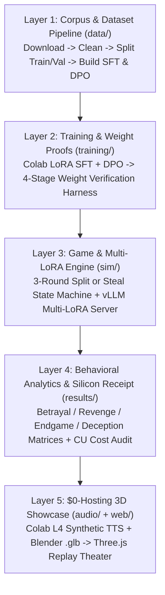

# Split or Steal — Layered Execution Plan & Vertical-Slice Blueprint

This plan breaks **Split or Steal — Persona Simulation Lab** into **five cleanly decoupled layers**, starting with a low-cost **2-character vertical slice** (`Machiavelli` vs. `Gandhi` on `Qwen/Qwen3-8B`) to scientifically prove that weight-level LoRA training (`SFT + DPO`) measurably shifts both *model weights* and *strategic decisions* beyond prompting — before scaling to the full 6-character cast and the 3D Blender apartment showcase.

---

## 1. Why Start With a 2-Character Vertical Slice First?

Before curating 6 corpora, training 12 LoRAs, running 3,150 games, and building a Three.js apartment, we must de-risk the **core ML hypothesis**:
> *Can fine-tuning an open-weights 8B model on primary-source text (`SFT`) and worldview preference pairs (`DPO`) genuinely override its polite RLHF default and change its Split or Steal decisions — measurably more than a system prompt alone?*

Running a **Vertical Slice** on the two most opposite public-domain personas (**Niccolò Machiavelli** vs. **Mahatma Gandhi**):
- Costs only **~4–8 Colab Compute Units** (<0.7% of our `1,209.41 CU` balance).
- Builds **~80% of the reusable ML pipeline** (`data/`, `training/`, `verify_weight_shift.py`, `sim/`), so expanding to 6 characters is purely configuration + data.
- Doubles as our **M4 vs. Colab GPU benchmark** on real workloads instead of synthetic toy loops.
- Produces concrete, inspectable proof (loss curves, perplexity matrix, logit shifts, and 20 head-to-head games) before committing larger compute or UI effort.

---

## 2. Model Selection Strategy (Small Enough to Iterate Fast, Smart Enough for Real Strategy)

| Model | Params | License / Access | Pros for This Project | Verdict |
| :--- | :---: | :--- | :--- | :--- |
| **`Qwen/Qwen3-8B`** | 8.2B | Apache 2.0 (ungated) | Native `<think>` reasoning maps directly to hidden monologue; zero HF gate friction; first-class Unsloth/TRL + vLLM Multi-LoRA support; trains in ~5–10 min/LoRA on A100; runs 4-bit locally on M4 24 GB. | **Primary Choice for Vertical Slice (v1)** |
| **`Qwen/Qwen3-14B`** | 14.8B | Apache 2.0 (ungated) | Deeper strategic reasoning & richer literary voice (great for Wilde/Machiavelli); still fits easily on A100 80 GB / G4 96 GB for vLLM Multi-LoRA (~2× training time of 8B). | **Optional Scale-Up** if 8B reasoning feels thin after Vertical Slice |
| **`meta-llama/Llama-3.1-8B-Instruct`** | 8.0B | Llama Community (gated) | Gold-standard baseline, rock-solid vLLM Multi-LoRA; requires HF approval token and tends to have stiffer RLHF refusals. | **Backup / Optional Cross-Family Ablation** |

**Why start from the Instruct checkpoint (not raw Base)?**
An instruct checkpoint already obeys multi-turn chat structure, understands game rules, and produces a realistic `Prompt-Only` control — while carrying the exact RLHF "polite assistant" prior we want to prove we can override with `SFT + DPO`.

---

## 3. How LoRA Fine-Tuning Works & How We Prove Weights Changed

### Mechanics (What Actually Happens to the Model)
1. **Freeze Base Weights ($W_0$):** The 8B base weights stay untouched (~16 GB in `bf16`).
2. **Attach Low-Rank Adapters ($\Delta W = \frac{\alpha}{r} B A$):** We inject trainable LoRA matrices (rank $r = 16$ or $32$, ~0.5%–1.5% of parameters, ~40–80 MB saved per character) across **all linear layers** (`q_proj, k_proj, v_proj, o_proj, gate_proj, up_proj, down_proj`) — critical for deep behavioral adaptation and vLLM Multi-LoRA compatibility.
3. **Stage 1 — SFT (Voice & Worldview):** Train on curated first-person Q&A / dialogue / correspondence examples built from the character's primary-source texts.
4. **Stage 2 — DPO (Decision Policy & Anti-RLHF Override):** Train on `(prompt, chosen, rejected)` dilemma pairs where:
   - `prompt` = an ethical, strategic, or interpersonal dilemma (**strictly NOT Split or Steal itself**, preventing trivial data leakage!).
   - `rejected` = the **actual generic polite RLHF response** generated by the base `Qwen3-8B` model.
   - `chosen` = an authentic in-character response grounded in the character's primary-source worldview.
   - DPO directly increases $\log \pi_\theta(\text{chosen} \mid x) - \log \pi_\theta(\text{rejected} \mid x)$, shifting the policy away from generic assistant defaults.

### Four Objective Proofs That Weights Changed & Shifted Behavior (`training/verify_weight_shift.py`)

| # | Proof Check | What It Measures | What Success Looks Like |
| :---: | :--- | :--- | :--- |
| **1** | **Weight-Space & Loss Audit** | Frobenius norm $\|\Delta W\|_F$ per layer + train vs. held-out validation loss curves | Non-zero structured adapter norms across attention & MLP blocks; smooth val-loss drop without memorization collapse |
| **2** | **Cross-Corpus Perplexity Matrix** | Perplexity of `Base`, `Machiavelli-SFT`, and `Gandhi-SFT` on **unseen held-out primary texts** from both authors | Machiavelli LoRA perplexity drops sharply on unseen Machiavelli text (and rises/stays flat on unseen Gandhi text), and vice versa |
| **3** | **Zero-Prompt Logit Probability Probe** | Feed identical neutral strategic/trust dilemmas with **NO persona system prompt**; read raw next-token probabilities $P(\text{defect})$ vs. $P(\text{cooperate})$ from logits across `Base` → `SFT` → `SFT+DPO` | Clear monotonic shift in raw decision probability *baked into the weights* with zero prompting |
| **4** | **3-Way Mini-Tournament (20 Games)** | Pit Machiavelli vs. Gandhi in 3-Round Split or Steal under `Prompt-Only`, `SFT`, and `SFT+DPO` | Measurable delta in First-Strike Betrayal Rate, Round 3 Backstab Rate, Deception Gap, and blind voice distinctiveness |

---

## 4. Five Decoupled Architecture Layers (Build Independently, Verify Each Gate)

### Layer 1 — Corpus & Dataset Engine (`data/`)
- **Goal:** Deterministic, version-controlled scripts that pull primary sources, clean OCR/formatting noise, isolate first-person voice, hold out a 10% validation set for perplexity proofs, and emit `sft_train.jsonl`, `sft_val.jsonl`, and `dpo_train.jsonl`.
- **Rights Hygiene:** Every character config declares `rights_tier: "public_domain" | "research_only"` so open-source exports cleanly filter out copyrighted/living-person texts.
- **Vertical Slice Sources (100% Public Domain):**
  - *Machiavelli:* Detmold 1882 English *The Prince*, *Discourses*, *Legations* (diplomatic dispatches), letters (Project Gutenberg / Internet Archive).
  - *Gandhi:* Pre-1931 US Public Domain English works (*Hind Swaraj*, *The Story of My Experiments with Truth*, *Satyagraha in South Africa*, pre-1931 letters/speeches).

### Layer 2 — Training & Weight-Verification Harness (`training/`)
- **Goal:** Headless Colab CLI runner (`training/run_colab_train.py`) using `trl` + `peft` (or `unsloth`) for reproducible LoRA SFT → DPO training with strict step/time caps and immediate GPU teardown.
- **M4 vs. Colab Benchmark:** Run the exact same 50-step micro-benchmark locally on Apple M4 (`mlx` / PyTorch MPS) vs. Colab `L4` / `A100` to capture real tokens/sec, speedup ratio, and live CU/hr burn rates for the Silicon Receipt.
- **Gate to Proceed:** All 4 objective weight proofs pass on Machiavelli & Gandhi before scaling to all 6 characters.

### Layer 3 — Simulation & vLLM Multi-LoRA Tournament Engine (`sim/`)
- **Goal:** Clean, testable Python state machine for 3-Round Escalating Split or Steal (\$100 → \$500 → \$1,000, 2 negotiation turns/round, hidden `<thought>`, strict structured `SPLIT`/`STEAL` output).
- **Serving:** Single `vLLM` OpenAI-compatible server on Colab `A100` / `G4` loading all character LoRA adapters simultaneously (`--enable-lora`), executing 50–100 batched games per matchup with 50/50 first-mover seat balancing.
- **3-Way Scientific Control:** Run identical seeds/matchups across `Prompt-Only`, `SFT`, and `SFT+DPO`.

### Layer 4 — Behavioral Analytics & Silicon Receipt (`results/`)
- **Goal:** Deterministic analysis scripts converting raw JSONL game logs into:
  - Per-character & per-regime scorecards (`Total Winnings`, `First-Strike Betrayal Rate`, `Revenge Rate`, `Forgiveness Rate`, `Round 3 Backstab Rate`, `Deception Gap`).
  - `Prompt` → `SFT` → `SFT+DPO` delta charts with confidence intervals.
  - Highlight-game selector (automatically picks the funniest, most dramatic, or most revealing games for Layer 5).
  - Exact Silicon Receipt (M4 vs. Colab speed + every CU spent).

### Layer 5 — Interactive 3D Showcase (`audio/` + `web/`)
- **Goal:** Static \$0-hosting web app completely decoupled from live GPU inference.
- **Audio (`audio/`):** Batch-render highlight game voice lines on Colab `L4` (~1–2 CUs) using open-source royalty-free synthetic TTS (e.g., Kokoro / Chatterbox — no real-person voice cloning).
- **3D Scene (`web/`):** Export Ayush's Blender apartment (`.blend` → compressed `.glb`) into React Three Fiber / Three.js, place stylized 3D avatars at the table with camera cuts, *Spoken vs. Inner Thought* toggle, and the interactive 6×6 analytics dashboard.

---

## 5. Phased Execution Roadmap & Compute Budget

| Sprint | Scope | Est. CUs | Exit Gate |
| :--- | :--- | :---: | :--- |
| **Sprint 1: Vertical Slice (NOW)** | Build Layer 1–3 core + M4 vs. Colab benchmark + train & prove weight shift on **Machiavelli vs. Gandhi** (`Qwen3-8B`) + 20-game 3-way control | ~4–8 CUs | All 4 weight-shift proofs pass & clear behavioral delta observed |
| **Sprint 2: Final 6-Cast Scale-Up** | Lock final 6 cast (`ADR-005`), decide `8B` vs. `14B`, ingest remaining 4 corpora, train remaining SFT+DPO LoRAs, run per-character probes | ~20–40 CUs | All 6 adapters pass voice & weight-shift verification |
| **Sprint 3: Full Tournament & Analytics** | Run full 21-matchup × 50–100 games × 3 regimes on vLLM Multi-LoRA (`A100`/`G4`); generate full `results/` scorecards & highlights | ~15–25 CUs | Statistically significant `Prompt` vs. `SFT` vs. `SFT+DPO` findings |
| **Sprint 4: Audio + 3D Apartment Web App** | Render highlight TTS on `L4`, export `.blend` → `.glb`, build Three.js replay theater + dashboard, deploy statically (\$0) | ~1–3 CUs | Live interactive showcase + clean open-source release prep |
| **Total v1** | | **~40–76 CUs** | **<7% of current `1,209.41 CU` balance** |

---

## 6. Division of Work (Autonomous Execution vs. Human Checkpoints)

- **Autonomous (Agent handles end-to-end, parallelizing independent modules via subagents):**
  - Writing & running corpus downloaders, cleaners, and SFT/DPO builders.
  - Implementing the 3-Round Split or Steal engine + unit tests + vLLM Multi-LoRA client.
  - Running the M4 local micro-benchmark and headless Colab GPU jobs (`colab-cli`), capturing live CU/hr burn rates, and tearing down sessions immediately.
  - Running all 4 weight-shift probes and generating charts/tables in `results/`.
  - Updating `docs/DECISIONS.md`, `docs/WORK_MAP.md`, `docs/LAB_NOTEBOOK.md`, and continuously committing + pushing to `origin/main`.
- **Human Checkpoints (Quick sign-offs where your taste/judgment matters):**
  1. **Now:** Approve Sprint 1 Vertical Slice (`Qwen3-8B`, Machiavelli vs. Gandhi) and say "Go".
  2. **After Sprint 1:** Inspect the real weight-shift numbers & sample Machiavelli vs. Gandhi transcripts → lock final 6 cast (`ADR-005`) and confirm `8B` vs. `14B`.
  3. **Sprint 4:** Provide the `.blend` apartment path and review 3D camera angles/avatar style.
