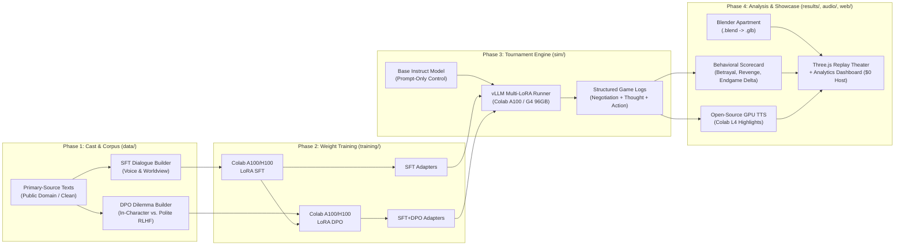

# Project Map, System Architecture & Evolution

A living bird's-eye map of **Split or Steal — Persona Simulation Lab**: how all components connect, how the repository is organized, how the project evolved over time, and every Compute Unit spent along the way.

---

## 1. End-to-End System Architecture

---

## 2. Repository Map

| Path | Purpose | Current State |
| :--- | :--- | :--- |
| `README.md` | High-level project pitch, game rules, and structure overview | Active |
| `PLAN.md` | Master roadmap, GPU budget targets, milestones, and open decisions | Active |
| `CAST_BRAINSTORM_PROMPT.md` | Unbiased prompt used to evaluate and select the final persona roster | Ready for use |
| `docs/DECISIONS.md` | Architecture & Experiment Decision Log (ADRs with tradeoffs & interview context) | Active (`ADR-001`–`ADR-004`) |
| `docs/WORK_MAP.md` | This file — system architecture, repo map, evolution timeline, and CU ledger | Active |
| `docs/LAB_NOTEBOOK.md` | Chronological engineering & experiment log (benchmarks, findings, pivots) | Active (`Entry 001`) |
| `data/` | Primary-source corpora and SFT/DPO dataset builders (raw/processed gitignored) | Scaffolded |
| `training/` | Colab GPU LoRA SFT + DPO training scripts and M4 vs. Cloud benchmarks | Scaffolded |
| `sim/` | 3-Round Split or Steal game engine, structured parser, and vLLM Multi-LoRA runner | Scaffolded |
| `audio/` | Open-source GPU TTS highlight rendering pipeline | Scaffolded |
| `web/` | Three.js / React Three Fiber 3D apartment replay theater & analytics dashboard | Scaffolded |
| `results/` | Committed JSON/CSV experiment summaries, behavioral matrices, and silicon receipts | Scaffolded |

---

## 3. Evolution Timeline (How the Project Built Up)

| Date (UTC) | Phase | Milestone | Key Changes / Decisions |
| :--- | :--- | :--- | :--- |
| 2026-11-25 | Phase 0 | Initial repo scaffold (`d941101`) | Established directory layout (`data/`, `training/`, `sim/`, `audio/`, `web/`, `results/`), `.gitignore` for large weights/datasets, `README.md`, and `PLAN.md`. |
| 2026-11-25 | Phase 0 | Cast selection tooling (`eff99e9`) | Added `CAST_BRAINSTORM_PROMPT.md` to run an unbiased, multi-model evaluation of candidate personas with explicit copyright/corpus scoring. |
| 2026-11-25 | Phase 0 | Local env + Colab CLI auth & docs framework | Verified Python 3.14.7 `.venv` + `google-colab-cli 0.8.0`, completed OAuth sign-in (`1,209.41 CUs` live balance), and initialized `docs/` (`DECISIONS.md`, `WORK_MAP.md`, `LAB_NOTEBOOK.md`). |

---

## 4. Compute & Cost Ledger (Silicon Receipt)

Target v1 budget: **~35–75 CUs** (kept well under 20% of a 1,000 CU/month Google AI Ultra allowance).

| Date (UTC) | Phase | Workload | Hardware | Duration | Live Rate (CU/hr) | CUs Spent | Balance After | Notes |
| :--- | :--- | :--- | :--- | :--- | :--- | :--- | :--- | :--- |
| 2026-11-25 | Phase 0 | Baseline OAuth & balance check | None (0 active) | — | 0.00 | 0.00 | **1,209.41** | Initial verified balance via `colab usage`. Supported CLI GPUs: `T4`, `L4`, `G4`, `A100`, `H100`. |

*Every future Colab job will append a row here with before/after `colab usage` readings so total spend is auditable down to 0.01 CU.*
