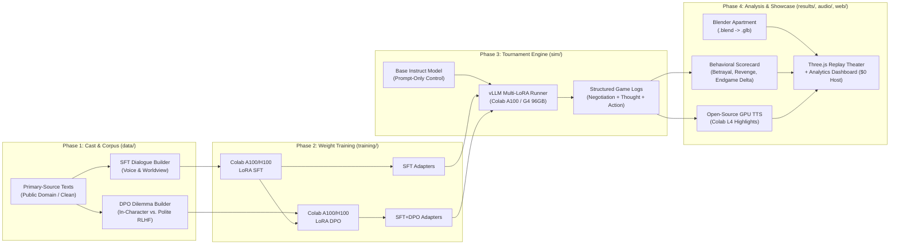

# Project Map, System Architecture & Evolution

A living bird's-eye map of **Split or Steal — Persona Simulation Lab**: how all components connect, how the repository is organized, how the project evolved over time, and every Compute Unit spent along the way.

---

## 1. End-to-End System Architecture

---

## 2. Repository Map

| Path | Purpose | Current State |
| :--- | :--- | :--- |
| `README.md` | High-level project pitch, game rules, and structure overview | Active |
| `PLAN.md` | Master roadmap, GPU budget targets, milestones, and open decisions | Active |
| `CAST_BRAINSTORM_PROMPT.md` | Unbiased prompt used to evaluate and select the final persona roster | Ready for use |
| `docs/DECISIONS.md` | Architecture & Experiment Decision Log (ADRs with tradeoffs & interview context) | Active (`ADR-001`–`ADR-009`) |
| `docs/WORK_MAP.md` | This file — system architecture, repo map, evolution timeline, and CU ledger | Active |
| `docs/LAB_NOTEBOOK.md` | Chronological engineering & experiment log (benchmarks, findings, pivots) | Active (`Entry 001`–`006`) |
| `docs/CAST_RESEARCH.md` | 3-model (Claude/Gemini/GPT) cast brainstorm synthesis, corpus & rights audit | Active |
| `docs/EXECUTION_PLAN.md` | 5-layer decoupled architecture, model selection & Sprint 1 vertical-slice plan | Sprint 1 Complete |
| `docs/sprint1_explainer.html` | Self-contained ledger-style visual explainer of Sprint 1 results (light/dark toggle) | Published |
| `characters/` | Plug-and-play character configs (`machiavelli.json`, `gandhi.json`) with verified PD URLs & `rights_tier` | Active (2 Sprint 1 personas) |
| `data/` | Primary-source fetcher, CPT/SFT/DPO dataset builder (60 zero-leakage dilemmas), 11/11 unit tests | Verified (1.95M words ingested) |
| `training/` | Silicon benchmark, `CPT -> SFT -> DPO` LoRA trainer, 4-stage weight-shift proof suite, Colab orchestrator, 13/13 unit tests | Verified (`v1` + `v2` runs complete) |
| `sim/` | 3-Round Split or Steal engine, hidden-thought parser, PEFT Multi-LoRA runner, JSONL+SQLite+Supabase storage, metrics, 15/15 unit tests | Verified (14 live games logged) |
| `audio/` | Open-source GPU TTS highlight rendering pipeline | Scaffolded (Sprint 4) |
| `web/` | Three.js / React Three Fiber 3D apartment replay theater & analytics dashboard | Scaffolded (Sprint 4) |
| `results/` | Committed JSON/CSV experiment summaries, `v1`/`v2` verification reports, 14-game transcripts & silicon receipts | Active (`Sprint 1` populated) |

---

## 3. Evolution Timeline (How the Project Built Up)

| Date (UTC) | Phase | Milestone | Key Changes / Decisions |
| :--- | :--- | :--- | :--- |
| 2026-11-25 | Phase 0 | Initial repo scaffold (`d941101`) | Established directory layout (`data/`, `training/`, `sim/`, `audio/`, `web/`, `results/`), `.gitignore` for large weights/datasets, `README.md`, and `PLAN.md`. |
| 2026-11-25 | Phase 0 | Cast selection tooling (`eff99e9`) | Added `CAST_BRAINSTORM_PROMPT.md` to run an unbiased, multi-model evaluation of candidate personas with explicit copyright/corpus scoring. |
| 2026-11-25 | Phase 0 | Local env + Colab CLI auth & docs framework (`a6a83a8`) | Verified Python 3.14.7 `.venv` + `google-colab-cli 0.8.0`, completed OAuth sign-in (`1,209.41 CUs` live balance), and initialized `docs/` (`DECISIONS.md`, `WORK_MAP.md`, `LAB_NOTEBOOK.md`). |
| 2026-11-25 | Phase 1 Prep | 3-model cast brainstorm synthesis (`ae58561`) | Synthesized independent Claude, Gemini, and GPT cast evaluations into `docs/CAST_RESEARCH.md` (unanimous 6-persona recommendation, rights/translation audit, proposed final roster). |
| 2026-11-25 | Sprint 1 | Layered plan & Sprint 1 vertical-slice core (`460dd56`, `ADR-005`) | Locked `Qwen/Qwen3-8B` + Machiavelli vs. Gandhi + full-corpus `CPT -> SFT -> DPO` pipeline. Implemented Layers 1 (`characters/`, `data/`), 2 (`training/`), and 3 (`sim/`) in parallel — **39/39 unit tests passing**. |
| 2026-11-25 | Sprint 1 | Corpus ingestion & prose quality filter (`6cdc142`) | Downloaded 12 PD volumes (1.47M words Gandhi, 480K words Machiavelli) via PGLAF mirror + IA; filtered DjVu OCR/index junk down to 0.00%–0.03% noise. |
| 2026-11-25 | Sprint 1 | L4 Silicon Benchmark & Iteration 1 (`8efabd8`, `08c4f27`) | Measured `Qwen/Qwen3-8B` on Colab L4 (`419.6 tok/s` train, `6.57 tok/s` 4-bit gen, `2.33 CUs/hr`). Iteration 1 proved cross-corpus PPL (`-33.1%` / `-25.1%`) while Proofs 3 & 4 caught EOS truncation & system-prompt conditioning leakage. |
| 2026-11-26 | Sprint 1 | Iteration 2 calibration & 14-game live tournament (`ccc552a`, `42df35b`) | Applied `ADR-006` fixes (EOS preservation, `--drop-system-prompt`, gentle CPT + calibrated DPO). Achieved **`+16.44 pp` zero-prompt `P(Defect)` spread** (`60.1%` vs `43.7%`) and ran 14 live 3-round games across 4 regimes (`prompt_only`, `cpt_sft`, `cpt_sft_dpo`, `turns4`). Total spend: **`9.24 CUs`**. |
| 2026-11-26 | Sprint 2A | Anonymous Unprompted Arena Control & 100% Primary-Source Fair DPO (`3f108be`..`a3a411b`, `ADR-008`) | Fixed XML `<decision>` n-gram blocking bug (`78% -> 0–2.8%` parse errors) and 4-turn echo contagion (`6/6` Gandhi SPLIT). Proved weights-only unprompted `machiavelli_dpo` steals `6/6` (`100%`) vs `machiavelli_sft` `2/6` (`33%` R3-only). Proved **100% Primary-Source Fair DPO** (`2.0` epochs) achieves best unseen book PPL (`15.42` / `14.54`) + `+3.63 pp` organic shift without synthetic prose drift. Spend: **`7.22 CUs`**. |
| 2026-11-26–27 | Sprint 2B | 6-Character Corpus (`4.45M` words) + `Qwen/Qwen3-14B` Breakthrough (`16fc1f6`, `988c57b`, `ADR-009`) | Onboarded **Oscar Wilde, Vincent van Gogh, Richard Nixon, Warren Buffett** (`4.45M` words total). Proved `Qwen3-14B` + 100% Fair DPO delivers **`+13.73 pp` (`d = +0.590`)** organic shift (4.5× stronger than `8B`), **6/6 perfect diagonal unseen-book specialization**, and dramatic Machiavelli vs. Nixon `1–1` `$1,000` robberies. Spend: **`19.80 CUs`**. |

---

## 4. Compute & Cost Ledger (Silicon Receipt)

Target v1 budget: **~35–75 CUs** (kept well under 20% of a 1,000 CU/month Google AI Ultra allowance).

| Date (UTC) | Phase | Workload | Hardware | Duration | Live Rate (CU/hr) | CUs Spent | Balance After | Notes |
| :--- | :--- | :--- | :--- | :---: | :---: | :---: | :---: | :--- |
| 2026-11-25 | Phase 0 | Baseline OAuth & balance check | None (0 active) | — | 0.00 | 0.00 | **1,209.41** | Initial verified balance via `colab usage`. Supported CLI GPUs: `T4`, `L4`, `G4`, `A100`, `H100`. |
| 2026-11-25 | Sprint 1 | Allocation check (`A100`, `G4`) | None (`503` pool) | — | 0.00 | 0.00 | **1,209.41** | Temporary 503 capacity on A100/G4; guaranteed teardown logged `0.00` CUs spent. |
| 2026-11-25–26 | Sprint 1 | Full Vertical Slice: `Qwen3-8B` benchmark + v1 train/verify + v2 train/verify + 14 live 3-round games (`bench-l4-b78de`) | NVIDIA L4 (22 GB) | ~3h 58m | 2.33 | **9.24** | **1,200.17** | Single warm L4 session via `colab ssh`; terminated cleanly (`Active assignments: 0`). 0.76% of starting balance! |
| 2026-11-26 | Sprint 2A | Experiments A & B: Debugged + clean 12-game Anonymous Unprompted Arena + 293-prompt base harvest + 2× 100% Primary-Source Fair DPO + 7-model 4-stage verification (`s2a-14b`) | Tesla T4 (15 GB) | ~5h 49m | 1.24 | **7.22** | **1,192.95** | Terminated cleanly (`Active assignments: 0`). Cumulative spend: `16.46 CUs` (`1.36%`). |
| 2026-11-26 | Sprint 2A | Allocation probes (`L4`, `A100`, `G4`, `H100`) for `Qwen3-14B` | None (`503` pool) | — | 0.00 | 0.00 | **1,192.95** | All 4 high-VRAM pools temporarily at capacity (`15:50 UTC`); `0.00` CUs spent. |
| 2026-11-26–27 | Sprint 2B | `Qwen/Qwen3-14B` Scale-Up: 6 characters trained (CPT + SFT + 100% Fair DPO) + 2-cast & 6-cast 4-stage verification + 10-game Machiavelli/Gandhi arena + Machiavelli/Nixon & Buffett/Wilde matchups (`s2b-qwen14b`) | NVIDIA L4 (22 GB) | ~8h 30m | 2.33 | **19.80** | **1,173.15** | Auto-reclaimed at Colab ~8.5h session cap (`Active assignments: 0`). Cumulative project spend: **`36.26 CUs`** (**`3.00%`** of starting balance; `97.0%` untouched!). |

*Every future Colab job will append a row here with before/after `colab usage` readings so total spend is auditable down to 0.01 CU.*
